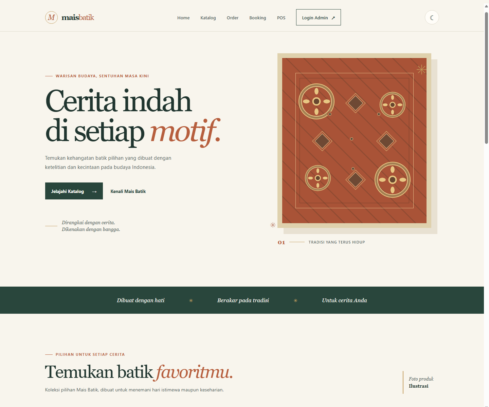

# Mais Batik

Mais Batik adalah **Sistem Informasi Bisnis Batik Terpadu** untuk membantu
pelanggan menemukan produk batik dan membantu admin mengelola katalog serta
pesanan dalam satu aplikasi web. Proyek ini menggabungkan pengalaman katalog
publik yang responsif dengan panel pengelolaan berbasis PHP dan MySQL.

## Fitur Utama dan Nilai Tambah

- **Katalog produk responsif** dengan informasi produk, kisaran harga, varian,
  stok, detail, dan aksi pemesanan.
- **Filter kategori dan pencarian interaktif** yang menyaring produk langsung
  tanpa memuat ulang halaman.
- **Mode terang dan gelap** yang mengikuti preferensi sistem dan menyimpan
  pilihan tema di browser.
- **Panel admin** untuk autentikasi serta pengelolaan data produk dan pesanan.
- **CRUD kategori terpisah** dengan slug unik; kategori yang masih dipakai
  produk tidak dapat dihapus.
- **POS multi-produk** yang mencatat transaksi dan item penjualan, mengambil
  harga dari database, serta mengurangi stok secara transaksional.
- **Formulir dengan validasi client-side dan server-side** untuk membantu
  memastikan data yang dikirim lengkap dan sesuai format.
- **Dialog konfirmasi** sebelum aksi penghapusan data.
- **Arsitektur modular** yang memisahkan kode publik, konfigurasi, model,
  penyimpanan data, dan aset antarmuka.
- **Keamanan dasar aplikasi**, termasuk penggunaan PDO, konfigurasi rahasia
  melalui environment, perlindungan CSRF, dan escaping keluaran.

## Teknologi dan Prasyarat

- PHP 8.1 atau lebih baru, dengan ekstensi **PDO MySQL** dan **mbstring**.
- MySQL atau MariaDB.
- Git dan MySQL client untuk instalasi lokal.
- Web server PHP untuk menjalankan aplikasi; Node.js/npm dan Composer tidak
  diperlukan untuk versi saat ini.

## Instalasi dan Menjalankan Secara Lokal

### 1. Clone repositori

Ganti `<URL_REPOSITORI>` dengan alamat repositori Git proyek:

```bash
git clone <URL_REPOSITORI>
cd <FOLDER_REPOSITORI>
```

### 2. Siapkan konfigurasi database

Salin file contoh konfigurasi menjadi file lokal. File `config/database.php`
tidak dilacak Git agar kredensial lokal tidak masuk ke repositori.

```powershell
Copy-Item config\database.php.example config\database.php
```

Atur environment database pada terminal PowerShell yang sama dengan terminal
yang akan digunakan untuk menjalankan server:

```powershell
$env:DB_HOST = "127.0.0.1"
$env:DB_PORT = "3306"
$env:DB_NAME = "mais_batik"
$env:DB_USERNAME = "nama_user_database"
$env:DB_PASSWORD = "kata_sandi_database"
```

`DB_PORT` menggunakan `3306` jika tidak ditentukan. Jangan memasukkan
kredensial asli ke source code atau repositori. Jika akun database lokal memang
tidak memakai kata sandi, `DB_PASSWORD` boleh dikosongkan atau tidak diatur.

### 3. Buat tabel dan impor skema

Skema membuat database `mais_batik` serta tabel produk dan pesanan. Jalankan
perintah dari root proyek:

```powershell
Get-Content -Raw database\schema.sql | mysql -u nama_user_database -p
```

Masukkan kata sandi MySQL saat diminta. Jika akun database tidak diizinkan
membuat database, buat `mais_batik` terlebih dahulu di MySQL, lalu hapus
perintah `CREATE DATABASE` dan `USE` dari salinan skema yang akan diimpor.

Jika memperbarui database proyek yang sudah ada, jalankan migrasi gambar produk
satu kali setelah skema tersedia:

```powershell
Get-Content -Raw database\migrations\20261030_replace_legacy_product_images.sql | mysql -u nama_user_database -p
```

Untuk database lama yang masih memakai kategori ENUM, jalankan migrasi kategori
dan POS setelah migrasi gambar:

```powershell
Get-Content -Raw database\migrations\20261030_categories_and_pos.sql | mysql -u nama_user_database -p
```

Database baru yang dibuat dari `database/schema.sql` sudah memiliki tabel
kategori dan POS, sehingga kedua migrasi upgrade tersebut tidak diperlukan.

### 4. Siapkan akun admin

Buat hash untuk kata sandi admin menggunakan PHP:

```powershell
php -r "echo password_hash('GantiDenganPasswordKuat', PASSWORD_DEFAULT), PHP_EOL;"
```

Simpan nama pengguna dan hash sebagai environment untuk sesi terminal tersebut:

```powershell
$env:ADMIN_USERNAME = "admin"
$env:ADMIN_PASSWORD_HASH = "<HASH_HASIL_PERINTAH>"
```

Jangan menggunakan contoh kata sandi di atas untuk akun nyata dan jangan
menyimpan kata sandi atau hash admin di repositori.

### 5. Jalankan server lokal

Dengan environment database dan admin telah diatur pada terminal yang sama:

```powershell
php -S 127.0.0.1:8000 -t public
```

Buka [http://127.0.0.1:8000](http://127.0.0.1:8000) untuk halaman awal,
[http://127.0.0.1:8000/katalog.php](http://127.0.0.1:8000/katalog.php) untuk
katalog database, dan [http://127.0.0.1:8000/admin/](http://127.0.0.1:8000/admin/)
untuk panel admin. Server bawaan PHP hanya untuk development lokal, bukan
production. Jika koneksi gagal, periksa service MySQL, nilai environment,
konfigurasi `config/database.php`, dan apakah skema sudah diimpor.

Untuk panduan deployment PHP/MySQL, lihat [DEPLOYMENT.md](./DEPLOYMENT.md).

## Struktur Repositori dan Alur Kode

```text
.
├── config/                  # Koneksi dan konfigurasi aplikasi
│   ├── connection.php
│   └── database.php.example
├── controllers/             # Validasi dan alur kategori serta POS
├── database/
│   ├── schema.sql           # Skema MySQL katalog, pesanan, kategori, dan POS
│   └── migrations/          # Migrasi upgrade untuk gambar, kategori, dan POS
├── models/                  # Repository produk, pesanan, kategori, dan POS
├── public/                  # Document root; halaman dan aset yang dapat diakses
│   ├── admin/index.php      # Login admin dan panel CRUD
│   ├── assets/
│   │   ├── css/             # Gaya storefront dan panel admin
│   │   ├── images/          # Ilustrasi produk
│   │   └── js/              # Interaksi katalog, admin, dan tema
│   ├── katalog.php          # Katalog publik dari database
│   └── index.html           # Halaman awal publik
├── routes/                  # Ruang untuk definisi rute
├── storage/                 # Area penyimpanan internal/unggahan
├── tests/                   # Pengujian
├── views/                   # Ruang untuk template antarmuka
├── DEPLOYMENT.md            # Panduan hosting PHP/MySQL
└── README.md
```

Permintaan admin masuk melalui `public/admin/index.php`, yang menerapkan
autentikasi dan CSRF lalu mengarahkan aksi kategori/POS ke controller terkait.
Controller memvalidasi input dan memanggil repository di `models/`; operasi POS
mengunci produk, memeriksa serta mengurangi stok, dan menyimpan transaksi beserta
itemnya dalam satu transaksi database. Koneksi di
`config/connection.php` menggunakan nilai dari konfigurasi database,
repository di `models/` menangani akses data, dan `database/schema.sql`
menyediakan struktur penyimpanan. HTML, CSS, JavaScript, serta gambar yang
disajikan ke browser berada di `public/`. Folder `controllers/`, `routes/`,
dan `views/` dapat dikembangkan lebih lanjut untuk pemisahan MVC yang lebih luas.

Atur document root web server ke `public/`. Simpan konfigurasi, model, dan
berkas internal lain di luar document root. Database harus disiapkan sebelum
katalog dinamis dan fitur CRUD dapat digunakan.

## Live Deployment

**Status:** aplikasi belum memiliki URL deployment aktif.

Belum ada URL live untuk ditautkan. Untuk menyiapkan hosting PHP/MySQL dan
mengaktifkan deployment, ikuti [panduan deployment](./DEPLOYMENT.md). Setelah
deployment selesai, ganti status ini dengan URL aplikasi, misalnya:
`https://mais-batik.example.com`.

## Screenshot

Berikut tampilan halaman awal Mais Batik yang dijalankan secara lokal:



Screenshot ini menampilkan ilustrasi katalog statis. Katalog berbasis database
dan panel admin memerlukan konfigurasi MySQL; keduanya belum ditampilkan pada
screenshot ini.
